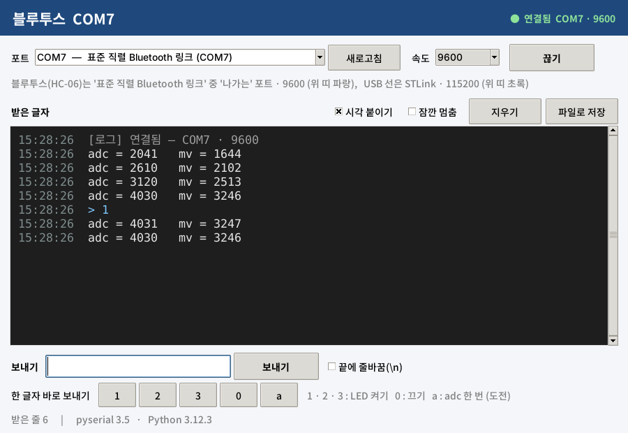

# incheon_mister_teaching_1 — 블루투스 로그 (Bluetooth PC side Project)

인천 전자 마이스터고 펌웨어 자율 전공 동아리 — 7주차 실습 4 (HC-06) 다음에 쓰는 프로그램.
보드가 블루투스(또는 USB 선)로 보낸 글자를 줄마다 시각과 함께 보여 주고, 노트북에서 글자를 보낼 수 있습니다.
크롬 웹 터미널 대신 쓰는 것입니다.

## 1. 파이썬 설치 (처음 한 번)

1. https://www.python.org › Downloads › **Windows** › 버전(예: 3.13.x) 아래의 **Windows installer (64-bit)** 받기
   - 맨 위 큰 버튼의 "Python install manager" 가 아니라 버전별 **installer (.exe)** 를 받습니다
2. 설치 첫 화면에서
   - 아래쪽 **"Add python.exe to PATH" 체크**
   - **"Use admin privileges when installing py.exe" 는 체크 해제** (관리자 권한 없이 설치)
   - **Install Now** 클릭 → 끝나면 **Close**
3. 시작 메뉴에 **IDLE (Python 3.x)** 가 생겼는지 확인

> pip · 명령 프롬프트 · .bat 은 쓰지 않습니다. 시리얼 도구(pyserial)가 이 폴더 안 `serial` 폴더에 이미 들어 있습니다.

## 2. 프로그램 받기

1. 이 페이지 위쪽의 초록색 **Code** 버튼 › **Download ZIP**
2. 받은 ZIP 을 오른쪽 클릭 › **압축 풀기** (ZIP 안에서 바로 실행하면 안 됩니다)
3. 풀린 폴더(`incheon_mister_teaching_1-main`) 안에 `btlog.py` 와 `serial` 폴더가 같이 있는지 확인

## 3. 실행

- `btlog.py` 를 **더블클릭**
- 안 열리면: 시작 메뉴 › **IDLE** › File › Open › `btlog.py` › **F5**

같이 뜨는 검은 창은 닫지 마세요 — 닫으면 프로그램도 꺼집니다.

## 4. 쓰는 법

| 순서 | 할 일 |
|---|---|
| ① | 크롬 웹 터미널의 블루투스 창은 닫기 — 같은 포트는 프로그램 하나만 열 수 있다 |
| ② | **포트** 고르기 — 블루투스는 `표준 직렬 Bluetooth 링크` 중 우리 조 TEAM 의 **'나가는'** 포트, USB 선은 `STLink` |
| ③ | **속도**는 포트를 고르면 저절로 (블루투스 9600 · USB 115200) |
| ④ | **연결** — 몇 초 뒤 HC-06 LED 가 깜빡임 → 계속 켜짐 |
| ⑤ | 보드가 보낸 줄이 시각과 함께 쌓인다 (`adc = 2048   mv = 1650`) |
| ⑥ | **1 · 2 · 3 · 0** 버튼 = 글자 하나 보내기 (실습 2 의 LED 명령) |
| ⑦ | **파일로 저장** — 지금까지 받은 로그를 .txt 로 |
| + | USB 선도 같이 보려면 `btlog.py` 를 한 번 더 열고 `STLink` — 위 띠 색으로 구별 (파랑 = 블루투스, 초록 = USB) |

'나가는' 포트 번호는 Windows 설정 › Bluetooth 및 장치 › 장치 › 기타 Bluetooth 설정 › **COM 포트** 탭에서 확인합니다.

## 5. 안 되면

| 증상 | 원인 · 해결 |
|---|---|
| 더블클릭하면 다른 프로그램이 열림 | IDLE 로 열고 F5 |
| `No module named 'serial'` | ZIP 안에서 열었거나 `serial` 폴더와 떨어짐 — 압축을 풀고 폴더째로 |
| `No module named 'tkinter'` | 설치 때 'tcl/tk and IDLE' 를 뺐음 — 기본값 그대로 다시 설치 |
| 포트 목록이 비어 있음 | 블루투스 짝 맺기 확인 → 새로고침 |
| 다른 프로그램이 이 포트를 쓰고 있음 | 크롬 웹 터미널 · 다른 창을 닫고 다시 연결 |
| 블루투스 연결 안 됨 | HC-06 전원(LED 깜빡임), '들어오는' 포트를 골랐는지 |
| 글자가 깨져 나옴 | 속도가 다름 — 블루투스 9600, USB 115200 |

## 파일

| 파일 | 내용 |
|---|---|
| `btlog.py` | 프로그램 본체 (tkinter) |
| `serial/` | pyserial 3.5 — 수정 없이 그대로 동봉 (BSD 라이선스, `LICENSE-pyserial.txt`) |
| `docs/` | 화면 캡처 |
